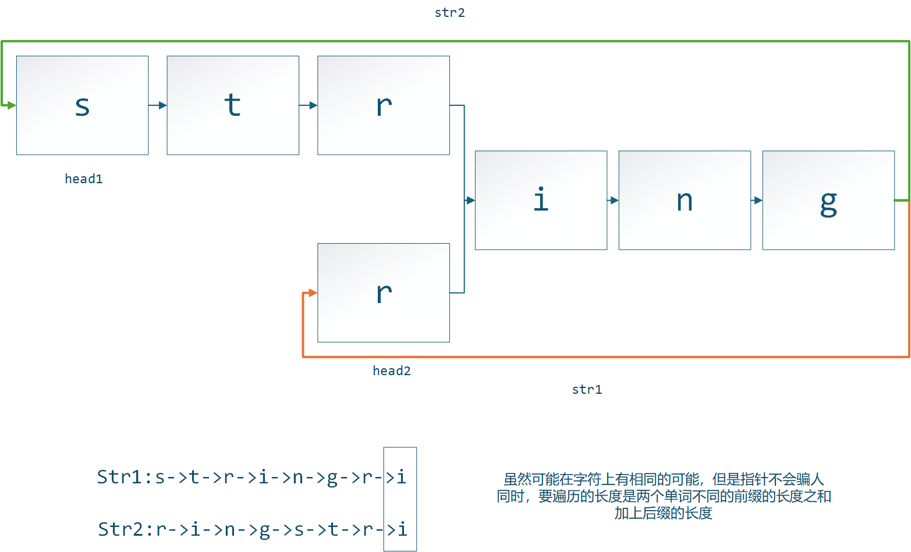

# 数据结构作业1  
## 题目1
### 解题思路
1. 首先设置两个指针记为`ptr1`和`ptr2`,且均置于链表的**头节点**；
2. 然后让`ptr2`指针先沿着链表**移动k个节点**，如果`ptr2`在完成k步移动之前已经到达了尾节点，那么直接返回0即可,到此结束无需进行接下来的步骤；
3. 然后每轮进行：先移动`ptr2`到下一个节点，然后再把`ptr1`移动到下一个节点。每轮一开始，如果发现`ptr2`指向的是空指针，那么此时$\color{red}{\texttt{ptr1}指向的就是倒数第k个数。}$
### 伪代码

```text
def FindKthFromEnd(list, k)
    ptr1 ← list
    ptr2 ← list

    for i ← 1 to k do
        if ptr2.link = NULL then
            return 0
        end if
        ptr2 ← ptr2.link
    end for

    while ptr2 ≠ NULL do
        ptr2 ← ptr2.link
        ptr1 ← ptr1.link
    end while

    输出 ptr1.data
    return 1
```

### 分析

**时间复杂度：** `ptr2` 沿链表向后遍历一次，`ptr1` 在同步移动阶段向后遍历部分结点，两个指针的移动总次数与 $n$ 成正比，复杂度为 $O(n)$。

**空间复杂度：** 只使用两个辅助指针和一个循环计数变量，额外空间复杂度为 $O(1)$。

---
## 题目2
### 解题思路
1. 先保存`str1`和`str2`头指针到`head1`和`head2`;
2. 然后开始逐轮让`str1`和`str2`向后移动一个节点，同时每轮都要比较一下`str1`和`str2`的指针的值是否相同；
3. 如果两个单词的长度不一致，当然第一轮其中一个指针遍历完一个单词之后，两者的指针一定没有相同过；
4. 不妨假定`str2`先遍历完成，这个时候我们把它$\color{red}{重新赋值到\texttt{head1}}$继续遍历；
5. 同理，当`str1`遍历完成，这个时候我们把它$\color{red}{重新赋值到\texttt{head2}}$继续遍历；
6. 像上述这样操作就可以保证两者一定可以在后缀起始点相遇，这个时候就找到了后缀共同的起始位置；
7. 考虑到两个单词可能没有共同后缀，所以可以给增加循环的上界m+n(m和n分别为两个单词的长度)。

**如图：**

### 伪代码

```text
def FindCommonSuffix(str1, str2)
    head1 ← str1.next
    head2 ← str2.next
    str1 ← head1
    str2 ← head2

    while str1 ≠ str2 do
        if str1 = NULL then
            str1 ← head2
        else
            str1 ← str1.next
        end if

        if str2 = NULL then
            str2 ← head1
        else
            str2 ← str2.next
        end if
    end while

    return str1
```

### 分析

**时间复杂度：** 每个指针最多遍历两条链表各一次，换表只需要常数次操作，因此时间复杂度为 $O(m+n)$。

**空间复杂度：** 只使用固定数量的辅助指针，额外空间复杂度为 $O(1)$。
